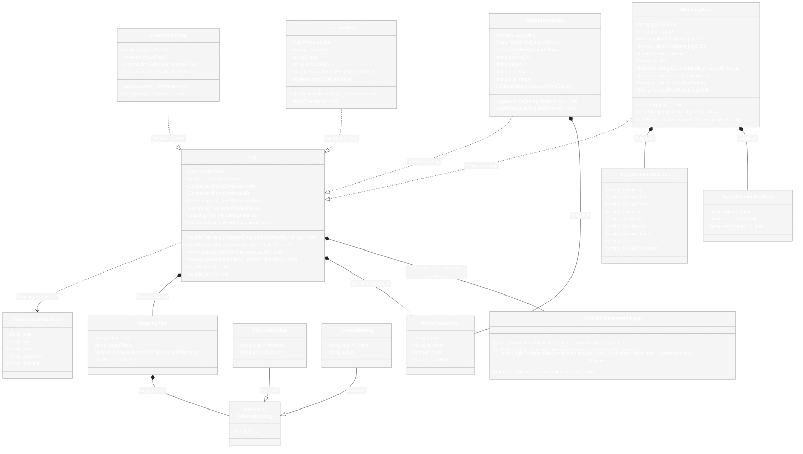

# Object-Oriented Class Design

While DataBridge Pro is a single-page React frontend integrated with a Node-based Vite plugin middleware, its logical structure maps perfectly to an object-oriented paradigm. This document translates the frontend components, state models, data objects, and backend handlers into cohesive classes to model their attributes, operational methods, and relationships.

## 📊 Class Diagram

The following UML Class Diagram represents the key entities of DataBridge Pro, styled using high-contrast Material Design parameters.

---

## 🏛 Class Explanations & Responsibilities

### 1. View Controller / Step Classes
These classes coordinate user interaction, input collection, and API handshakes for their respective views.

- **`App`**: The main coordinator controller. It implements the root wizard state machine (`connection`, `tables`, `mapping`, `transfer`), and routes central data sets (such as mapping queues, active connection models) downwards.
- **`ConnectionStep`**: Houses interactive state for credentials, visibility of passwords, and delegates connection verification triggers.
- **`TableListingStep`**: Filters tables, initiates schemas previews in a modal, and processes selections.
- **`MappingStep`**: Manages column alignment. Invokes name matching heuristics, drag-drop state transformations, and literal field overrides.
- **`TransferStep`**: Implements the execution coordinator. Interfaces with the abort triggers, captures live-console buffers, and calculates visual pipeline progress.

### 2. Model & DTO Classes
State structures passed around the application to maintain migration mappings and configuration parameters.

- **`ConnectionFormState`**: A structured entity containing the host, port, user credentials, password, and database schema name.
- **`MappingPlan`**: Ties a source table and target table pair to column alignment instructions. Includes an optional non-empty row filter rule.
- **`ColumnBinding` (with subclasses `SourceBinding` and `LiteralBinding`)**: Formulates structural assignment targets. Tracks either mapped source keys or strict literals.
- **`MysqlTableRow`**: A direct structure mapping to the results returned by schema table scans.
- **`MysqlColumnSchema`**: Defines columns and structural database properties.
- **`MysqlForeignKeyRow`**: Tracks a column's foreign key reference relationships to manage execution order hierarchy constraints.

### 3. Service / Server-side Classes
- **`TestDbConnectionPlugin`**: The node-side controller active in the Vite server ecosystem. Implements connection pools, intercepts HTTP `/api` operations, quotes database identifiers safely, manages batch iterations, and handles transactional commits/rollbacks.
