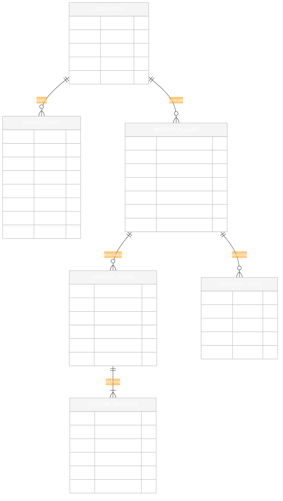

# Database Architecture & Schema Reference

This document outlines the PostgreSQL schema representing the operational database configuration for **DataBridge Pro**. While the application during development interfaces with temporary connections, a production-grade deployments manages state, metadata, mappings, and logs in an internal operational metadata store.

## 🏗 Entity-Relationship Diagram (ERD)

The following diagram illustrates the relationship between metadata entities, formatted in high-contrast Material Design syntax.

---

## 🗃 Table Definitions & Indexes

### 1. `projects`
Stores overall migration project environments.

| Field | Type | Nullable | Description | Key |
| --- | --- | --- | --- | --- |
| `id` | `uuid` | NO | Unique project identifier | PK |
| `name` | `varchar(255)` | NO | Name of the migration project | |
| `description` | `text` | YES | Optional descriptive text | |
| `created_at` | `timestamp` | NO | Creation date | |
| `updated_at` | `timestamp` | NO | Modification date | |

- **Indexes**:
  - `projects_pkey` (Primary Key on `id`)

---

### 2. `connections`
Maintains configured connections per project (e.g., source and target).

| Field | Type | Nullable | Description | Key |
| --- | --- | --- | --- | --- |
| `id` | `uuid` | NO | Unique connection identifier | PK |
| `project_id` | `uuid` | NO | Project the connection belongs to | FK |
| `type` | `varchar(50)` | NO | Type of database connection (`source` or `destination`) | |
| `host` | `varchar(255)` | NO | Database server host domain or IP | |
| `port` | `integer` | NO | Database connection port | |
| `db_user` | `varchar(255)` | NO | Username | |
| `db_name` | `varchar(255)` | NO | Name of the schema / database | |
| `created_at` | `timestamp` | NO | Metadata record timestamp | |

- **Indexes**:
  - `connections_pkey` (Primary Key on `id`)
  - `connections_project_id_idx` (Index on `project_id` for quick lookups)

---

### 3. `migration_jobs`
Represents an instance of a queued/executed data transfer workflow.

| Field | Type | Nullable | Description | Key |
| --- | --- | --- | --- | --- |
| `id` | `uuid` | NO | Unique migration execution run ID | PK |
| `project_id` | `uuid` | NO | Reference to the project | FK |
| `status` | `varchar(50)` | NO | Execution status (`idle`, `running`, `completed`, `aborted`, `failed`) | |
| `total_jobs` | `integer` | NO | Count of tables included in the transfer | |
| `progress_percentage` | `integer` | NO | Current progression score (0 to 100) | |
| `started_at` | `timestamp` | YES | Execution start timestamp | |
| `completed_at` | `timestamp` | YES | Execution completion timestamp | |

- **Indexes**:
  - `migration_jobs_pkey` (Primary Key on `id`)
  - `migration_jobs_project_id_idx` (Index on `project_id`)

---

### 4. `mapping_plans`
Stores table-to-table mappings grouped under an execution job.

| Field | Type | Nullable | Description | Key |
| --- | --- | --- | --- | --- |
| `id` | `uuid` | NO | Unique mapping plan record ID | PK |
| `job_id` | `uuid` | NO | Grouping migration job | FK |
| `source_table` | `varchar(255)` | NO | Name of the source table | |
| `target_table` | `varchar(255)` | NO | Name of the destination table | |
| `row_filter_column` | `varchar(255)` | YES | Field name used to assert non-empty rows | |
| `sequence_order` | `integer` | NO | Sequence hierarchy execution rank | |

- **Indexes**:
  - `mapping_plans_pkey` (Primary Key on `id`)
  - `mapping_plans_job_id_idx` (Index on `job_id`)
  - `mapping_plans_source_target_idx` (Index on `source_table`, `target_table`)

---

### 5. `column_bindings`
Documents column mapping rules for each table pair.

| Field | Type | Nullable | Description | Key |
| --- | --- | --- | --- | --- |
| `id` | `uuid` | NO | Unique column binding record ID | PK |
| `mapping_plan_id` | `uuid` | NO | Owning mapping plan ID | FK |
| `target_column` | `varchar(255)` | NO | Target column identifier | |
| `binding_kind` | `varchar(50)` | NO | Binding mechanism (`source` or `literal`) | |
| `source_column` | `varchar(255)` | YES | Associated source column | |
| `literal_value` | `text` | YES | Value assigned for literal mappings | |

- **Indexes**:
  - `column_bindings_pkey` (Primary Key on `id`)
  - `column_bindings_mapping_plan_id_idx` (Index on `mapping_plan_id`)

---

### 6. `transfer_logs`
Saves detailed log statements output by the migration execution pipeline.

| Field | Type | Nullable | Description | Key |
| --- | --- | --- | --- | --- |
| `id` | `uuid` | NO | Unique log identifier | PK |
| `job_id` | `uuid` | NO | Association with the running job | FK |
| `log_level` | `varchar(50)` | NO | Logging severity (`INFO`, `SUCCESS`, `WARN`, `ERROR`) | |
| `message` | `text` | NO | Formatted text representation of events | |
| `logged_at` | `timestamp` | NO | Recording timestamp | |

- **Indexes**:
  - `transfer_logs_pkey` (Primary Key on `id`)
  - `transfer_logs_job_id_idx` (Index on `job_id` for retrieval during live streaming)
  - `transfer_logs_logged_at_idx` (Index on `logged_at` for sequencing logs chronological)
